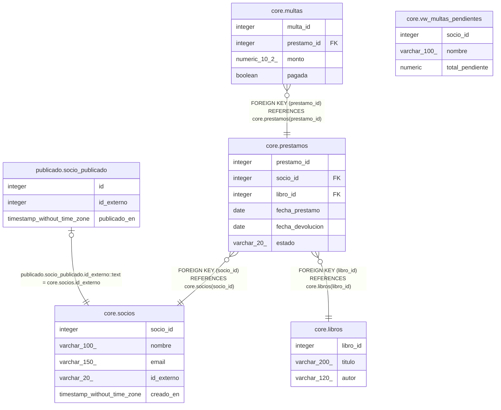

# demo_dd

## Tables

| Name | Columns | Comment | Type |
| ---- | ------- | ------- | ---- |
| [core.socios](core.socios.md) | 5 | Personas inscritas en la biblioteca | BASE TABLE |
| [core.libros](core.libros.md) | 3 | Catálogo de libros | BASE TABLE |
| [core.prestamos](core.prestamos.md) | 6 | Préstamo de un libro a un socio | BASE TABLE |
| [core.multas](core.multas.md) | 4 | Multas por devolución tardía | BASE TABLE |
| [publicado.socio_publicado](publicado.socio_publicado.md) | 3 | Socios enviados al sistema externo | BASE TABLE |
| [core.vw_multas_pendientes](core.vw_multas_pendientes.md) | 3 | Total de multas sin pagar por socio | VIEW |

## Stored procedures and functions

| Name | ReturnType | Arguments | Type |
| ---- | ------- | ------- | ---- |
| core.fn_marcar_devuelto | trigger |  | FUNCTION |

## Relations

---

> Generated by [tbls](https://github.com/k1LoW/tbls)
