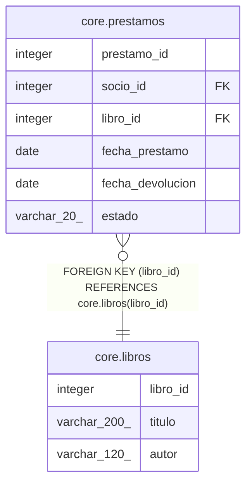

# core.libros

## Description

Catálogo de libros

## Columns

| Name | Type | Default | Nullable | Children | Parents | Comment |
| ---- | ---- | ------- | -------- | -------- | ------- | ------- |
| libro_id | integer | nextval('core.libros_libro_id_seq'::regclass) | false | [core.prestamos](core.prestamos.md) |  |  |
| titulo | varchar(200) |  | false |  |  |  |
| autor | varchar(120) |  | true |  |  | Nombre del autor tal como aparece en la portada |

## Constraints

| Name | Type | Definition |
| ---- | ---- | ---------- |
| libros_pkey | PRIMARY KEY | PRIMARY KEY (libro_id) |

## Indexes

| Name | Definition |
| ---- | ---------- |
| libros_pkey | CREATE UNIQUE INDEX libros_pkey ON core.libros USING btree (libro_id) |

## Relations

---

> Generated by [tbls](https://github.com/k1LoW/tbls)
