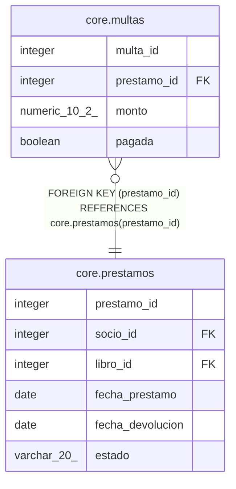

# core.multas

## Description

Multas por devolución tardía

## Columns

| Name | Type | Default | Nullable | Children | Parents | Comment |
| ---- | ---- | ------- | -------- | -------- | ------- | ------- |
| multa_id | integer | nextval('core.multas_multa_id_seq'::regclass) | false |  |  |  |
| prestamo_id | integer |  | false |  | [core.prestamos](core.prestamos.md) |  |
| monto | numeric(10,2) |  | false |  |  |  |
| pagada | boolean | false | true |  |  |  |

## Constraints

| Name | Type | Definition |
| ---- | ---- | ---------- |
| multas_prestamo_id_fkey | FOREIGN KEY | FOREIGN KEY (prestamo_id) REFERENCES core.prestamos(prestamo_id) |
| multas_pkey | PRIMARY KEY | PRIMARY KEY (multa_id) |

## Indexes

| Name | Definition |
| ---- | ---------- |
| multas_pkey | CREATE UNIQUE INDEX multas_pkey ON core.multas USING btree (multa_id) |

## Relations

---

> Generated by [tbls](https://github.com/k1LoW/tbls)
