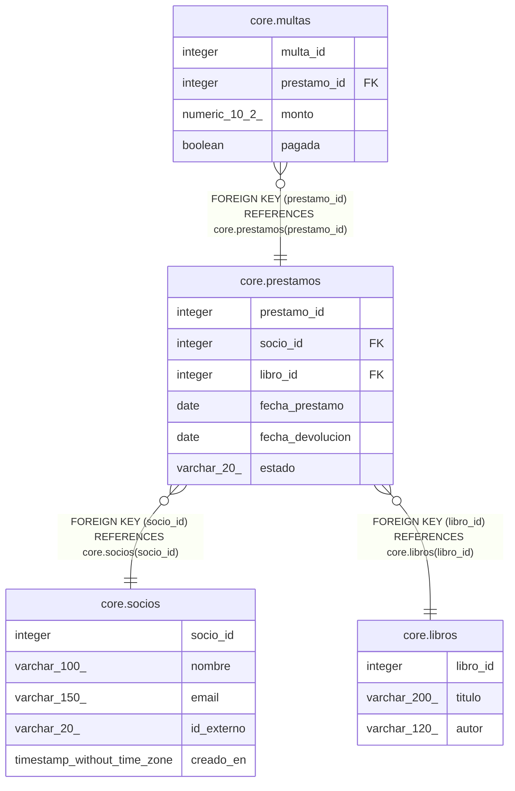

# core.prestamos

## Description

Préstamo de un libro a un socio

## Columns

| Name | Type | Default | Nullable | Children | Parents | Comment |
| ---- | ---- | ------- | -------- | -------- | ------- | ------- |
| prestamo_id | integer | nextval('core.prestamos_prestamo_id_seq'::regclass) | false | [core.multas](core.multas.md) |  |  |
| socio_id | integer |  | false |  | [core.socios](core.socios.md) |  |
| libro_id | integer |  | false |  | [core.libros](core.libros.md) |  |
| fecha_prestamo | date | CURRENT_DATE | false |  |  |  |
| fecha_devolucion | date |  | true |  |  |  |
| estado | varchar(20) | 'ABIERTO'::character varying | false |  |  | ABIERTO, DEVUELTO o VENCIDO |

## Constraints

| Name | Type | Definition |
| ---- | ---- | ---------- |
| prestamos_socio_id_fkey | FOREIGN KEY | FOREIGN KEY (socio_id) REFERENCES core.socios(socio_id) |
| prestamos_libro_id_fkey | FOREIGN KEY | FOREIGN KEY (libro_id) REFERENCES core.libros(libro_id) |
| prestamos_pkey | PRIMARY KEY | PRIMARY KEY (prestamo_id) |

## Indexes

| Name | Definition |
| ---- | ---------- |
| prestamos_pkey | CREATE UNIQUE INDEX prestamos_pkey ON core.prestamos USING btree (prestamo_id) |

## Triggers

| Name | Definition |
| ---- | ---------- |
| trg_marcar_devuelto | CREATE TRIGGER trg_marcar_devuelto BEFORE UPDATE ON core.prestamos FOR EACH ROW EXECUTE FUNCTION core.fn_marcar_devuelto() |

## Relations

---

> Generated by [tbls](https://github.com/k1LoW/tbls)
