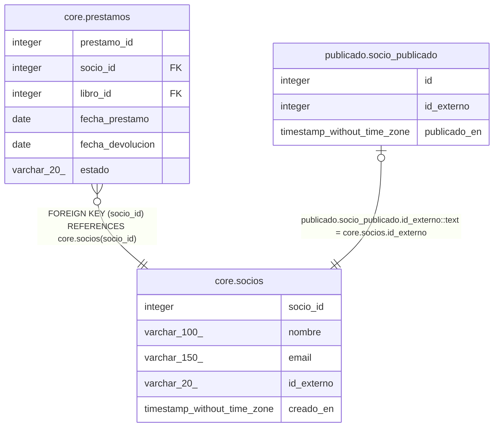

# core.socios

## Description

Personas inscritas en la biblioteca

## Columns

| Name | Type | Default | Nullable | Children | Parents | Comment |
| ---- | ---- | ------- | -------- | -------- | ------- | ------- |
| socio_id | integer | nextval('core.socios_socio_id_seq'::regclass) | false | [core.prestamos](core.prestamos.md) |  |  |
| nombre | varchar(100) |  | false |  |  |  |
| email | varchar(150) |  | true |  |  |  |
| id_externo | varchar(20) |  | true | [publicado.socio_publicado](publicado.socio_publicado.md) |  | Identificador usado por el sistema externo |
| creado_en | timestamp without time zone | now() | true |  |  |  |

## Constraints

| Name | Type | Definition |
| ---- | ---- | ---------- |
| socios_pkey | PRIMARY KEY | PRIMARY KEY (socio_id) |
| socios_email_key | UNIQUE | UNIQUE (email) |
| socios_id_externo_key | UNIQUE | UNIQUE (id_externo) |

## Indexes

| Name | Definition |
| ---- | ---------- |
| socios_pkey | CREATE UNIQUE INDEX socios_pkey ON core.socios USING btree (socio_id) |
| socios_email_key | CREATE UNIQUE INDEX socios_email_key ON core.socios USING btree (email) |
| socios_id_externo_key | CREATE UNIQUE INDEX socios_id_externo_key ON core.socios USING btree (id_externo) |

## Relations

---

> Generated by [tbls](https://github.com/k1LoW/tbls)
