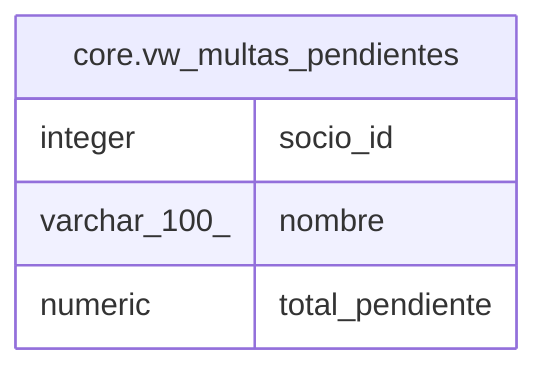

# core.vw_multas_pendientes

## Description

Total de multas sin pagar por socio

<details>
<summary><strong>Table Definition</strong></summary>

```sql
CREATE VIEW vw_multas_pendientes AS (
 SELECT s.socio_id,
    s.nombre,
    sum(m.monto) AS total_pendiente
   FROM ((core.multas m
     JOIN core.prestamos p ON ((p.prestamo_id = m.prestamo_id)))
     JOIN core.socios s ON ((s.socio_id = p.socio_id)))
  WHERE (NOT m.pagada)
  GROUP BY s.socio_id, s.nombre
)
```

</details>

## Columns

| Name | Type | Default | Nullable | Children | Parents | Comment |
| ---- | ---- | ------- | -------- | -------- | ------- | ------- |
| socio_id | integer |  | true |  |  |  |
| nombre | varchar(100) |  | true |  |  |  |
| total_pendiente | numeric |  | true |  |  |  |

## Referenced Tables

| Name | Columns | Comment | Type |
| ---- | ------- | ------- | ---- |
| [core.multas](core.multas.md) | 4 | Multas por devolución tardía | BASE TABLE |
| [core.prestamos](core.prestamos.md) | 6 | Préstamo de un libro a un socio | BASE TABLE |
| [core.socios](core.socios.md) | 5 | Personas inscritas en la biblioteca | BASE TABLE |

## Relations



---

> Generated by [tbls](https://github.com/k1LoW/tbls)
