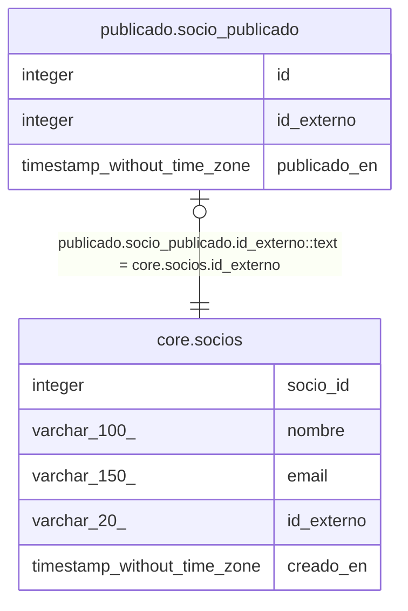

# publicado.socio_publicado

## Description

Socios enviados al sistema externo

## Columns

| Name | Type | Default | Nullable | Children | Parents | Comment |
| ---- | ---- | ------- | -------- | -------- | ------- | ------- |
| id | integer | nextval('publicado.socio_publicado_id_seq'::regclass) | false |  |  |  |
| id_externo | integer |  | false |  | [core.socios](core.socios.md) | Equivale a core.socios.id_externo (con cast a texto) |
| publicado_en | timestamp without time zone |  | true |  |  |  |

## Constraints

| Name | Type | Definition |
| ---- | ---- | ---------- |
| socio_publicado_pkey | PRIMARY KEY | PRIMARY KEY (id) |

## Indexes

| Name | Definition |
| ---- | ---------- |
| socio_publicado_pkey | CREATE UNIQUE INDEX socio_publicado_pkey ON publicado.socio_publicado USING btree (id) |

## Relations

---

> Generated by [tbls](https://github.com/k1LoW/tbls)
